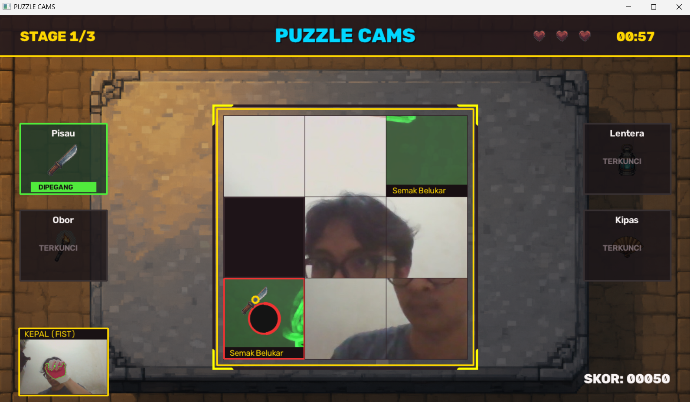
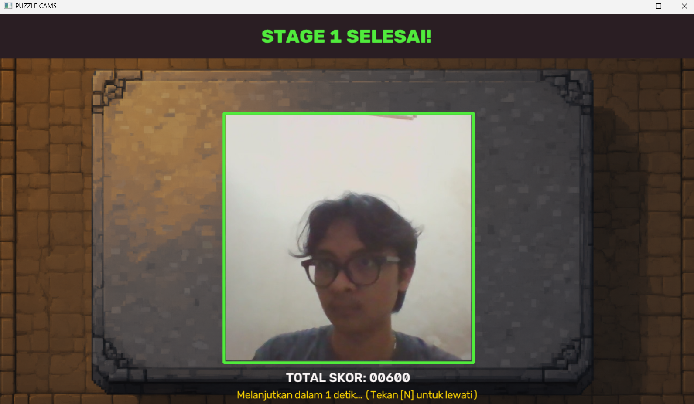
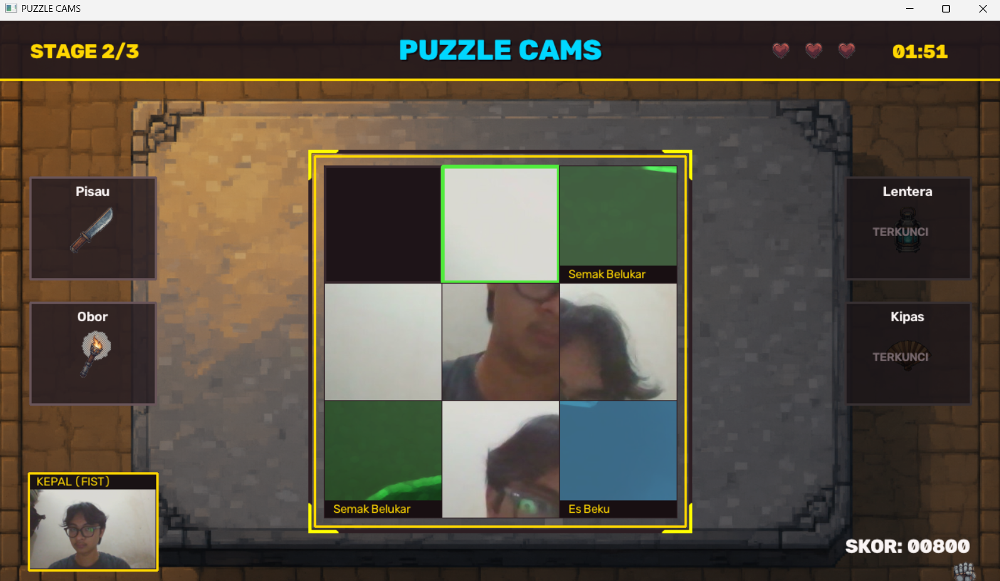
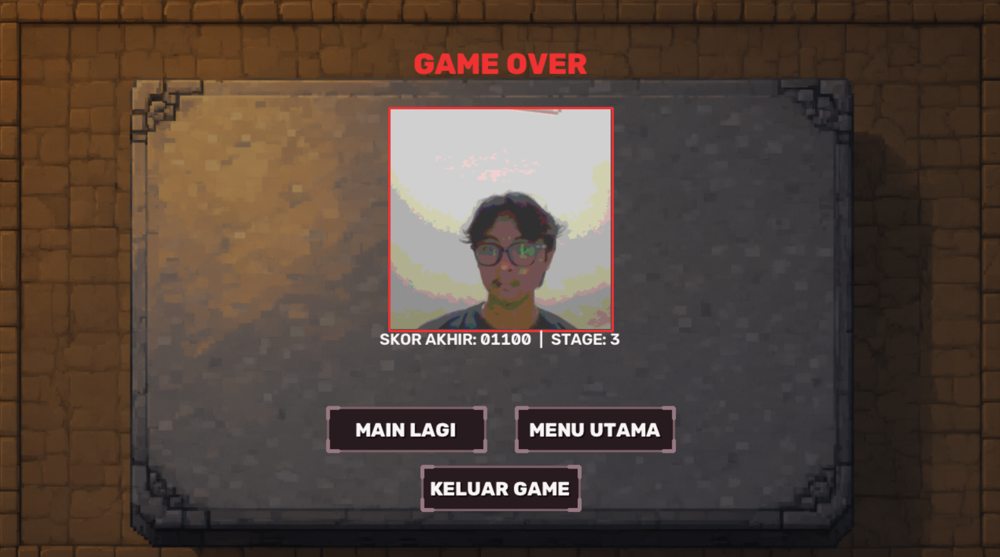
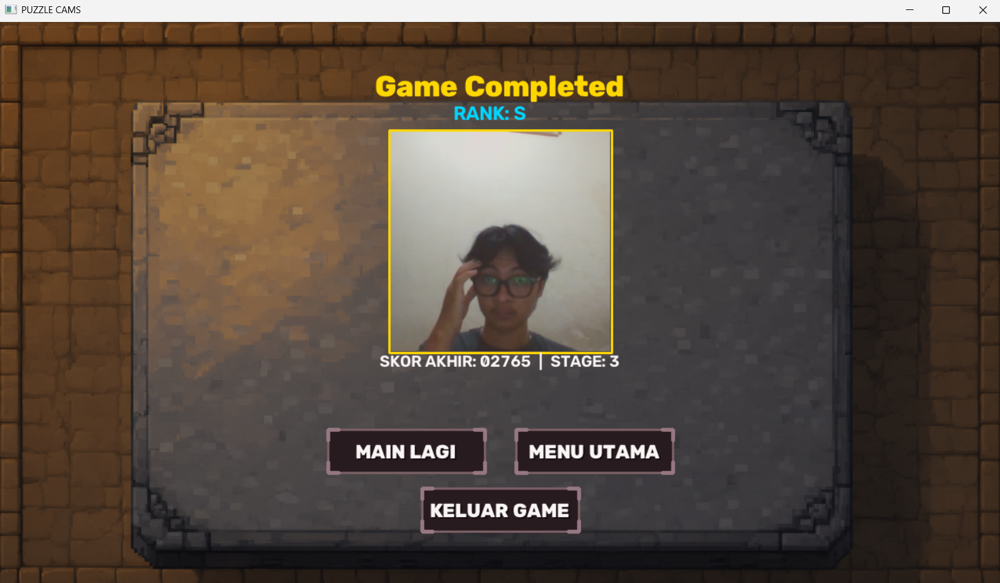

# Puzzle Cams

Puzzle Cams adalah permainan *sliding puzzle* interaktif yang dikendalikan menggunakan kamera web (*webcam*) melalui pelacakan warna dan pengenalan gestur tangan secara *real-time*. Pemain berinteraksi dengan permainan secara langsung tanpa menyentuh papan ketik maupun tetikus, mulai dari proses kalibrasi kontrol, pengambilan foto pribadi untuk dijadikan materi puzzle, hingga pengoperasian alat untuk membebaskan kepingan puzzle yang terkunci oleh rintangan (*obstacle*).

---

## 1. Gambaran Umum dan Tujuan Permainan

Tujuan utama dalam Puzzle Cams adalah menata kembali kepingan-kepingan foto yang telah diacak ke dalam susunan matriks 3x3 yang benar (terdiri dari 8 kepingan gambar dan 1 kotak kosong). Permainan dibagi ke dalam 3 tingkatan stage yang menyajikan tantangan berjenjang:

1. **Stage 1:** Tingkat pengacakan dasar dengan rintangan awal berupa semak belukar.
2. **Stage 2:** Tingkat pengacakan menengah dengan kombinasi rintangan semak belukar dan es beku.
3. **Stage 3:** Tingkat pengacakan tertinggi di mana seluruh jenis rintangan magis aktif secara dinamis.

Pemain harus mengendalikan kursor di layar menggunakan gerakan tangan, menggeser kepingan puzzle yang sah, serta mengambil peralatan (*tools*) pembebas untuk membersihkan rintangan sebelum papan permainan mengalami kebuntuan (*deadlock*).

---

## 2. Alur Permainan

Permainan Puzzle Cams berjalan melalui rangkaian tahapan yang berurutan, mulai dari menu pembuka hingga layar akhir permainan.

### 2.1. Main Menu

*Tampilan awal permainan dengan opsi tombol interaktif.*

Layar Main Menu menyambut pemain dengan latar belakang kastil arkade dan dua tombol pilihan utama:
- **MAIN:** Memulai rangkaian permainan baru yang akan mengarahkan pemain ke tahap kalibrasi warna.
- **KELUAR:** Menutup dan menghentikan aplikasi permainan.

Pemain dapat memilih menu menggunakan klik tetikus atau menekan tombol `[SPACE]` pada papan ketik untuk langsung beralih ke tahap kalibrasi.

### 2.2. Calibration (Kalibrasi Warna Kursor)

.png)
*Proses kalibrasi warna tangan atau objek penanda kursor.*

Tahap kalibrasi bertujuan mengunci profil warna tangan pemain agar kursor dapat digerakkan secara stabil. 

Pemain menempatkan telapak tangan (atau objek berwarna seperti sarung tangan) tepat di dalam kotak kuning *Region of Interest* (ROI) berukuran 180x180 piksel di tengah layar, kemudian menekan tombol `[SPACE]`. 

Sistem menjalankan empat fase pembacaan yang ditunjukkan oleh bilah progres visual:
1. **Menyiapkan (0% – 15%):** Inisialisasi area sensor kamera.
2. **Membaca warna (15% – 75%):** Mengumpulkan 30 sampel nilai warna pada area ROI.
3. **Mengkalibrasi warna (75% – 95%):** Menghitung batas toleransi ruang warna dan ukuran referensi tangan.
4. **Kalibrasi selesai (100%):** Ditandai dengan warna hijau pada bilah progres sebelum sistem otomatis berpindah ke tahap pengambilan foto.

Jika objek terlalu gelap atau warna tidak memenuhi syarat kestabilan, layar menampilkan status kegagalan dan pemain dapat menekan `[SPACE]` untuk mengulang pembacaan.

### 2.3. Capture (Pengambilan Foto Puzzle)

*Pengambilan foto wajah pemain menggunakan gestur tangan mengepal.*

Sebelum puzzle dimulai pada setiap stage, pemain mengambil foto wajah atau objek yang akan dipotong menjadi kepingan-kepingan puzzle. 

Pemain memosisikan diri di dalam kotak panduan bujursangkar 400x400 piksel di layar, lalu **mengepalkan tangan selama 1.5 detik** (atau menekan tombol `[SPACE]`). Tindakan ini memicu indikator pengisian hijau dan hitung mundur 3 detik. Saat hitungan berakhir, efek kilatan blitz kamera (*white flash*) muncul, dan area dalam bingkai dipotong menjadi citra berukuran 450x450 piksel untuk dibagikan ke dalam 9 kepingan puzzle (ukuran 150x150 piksel per keping).

### 2.4. Gameplay (Permainan Aktif)

*Layar permainan aktif pada Stage 1 menampilkan papan puzzle, rak peralatan, dan indikator status.*

Layar gameplay memuat seluruh elemen aktif permainan:
- **Bilah Status Atas (HUD):** Menampilkan nomor stage saat ini (`STAGE 1/3`), judul game, sisa nyawa (3 lambang hati), dan pencatat waktu permainan (*timer*).
- **Papan Puzzle Tengah:** Bidang berbingkai batu yang memuat 8 kepingan gambar dan 1 kotak kosong.
- **Rak Peralatan Samping:** Dua slot di sisi kiri (Pisau dan Obor) serta dua slot di sisi kanan (Lentera dan Kipas). Slot yang belum aktif pada stage tertentu ditandai dengan status `TERKUNCI`.
- **Kamera Mini (PiP):** Terletak di pojok kiri bawah, menampilkan umpan langsung kamera beserta deteksi kontur tangan hijau dan label status gestur (`KEPAL (FIST)` atau `BUKA (OPEN)`).
- **Teks Skor:** Ditampilkan secara bersih di pojok kanan bawah layar (`SKOR: 00050`), memanfaatkan ruang kosong agar tidak menutupi papan permainan.

### 2.5. Stage Completed (Penyelesaian Stage)

*Layar penyelesaian stage yang memperlihatkan foto utuh puzzle dan akumulasi skor.*

Kondisi ini tercapai ketika pemain berhasil menyusun seluruh kepingan puzzle kembali ke posisi sempurna. Layar menampilkan:
- Teks konfirmasi hijau `STAGE X SELESAI!`.
- Gambar foto utuh tanpa potongan kepingan di tengah bingkai batu.
- Total akumulasi skor yang telah diperoleh pemain.
- Hitung mundur 3 detik sebelum otomatis melanjutkan ke tahap berikutnya (pemain dapat menekan tombol `[N]` untuk langsung melewati jeda).

Jika pemain menyelesaikan Stage 1 atau Stage 2, permainan berpindah kembali ke tahap Capture untuk mengambil foto baru pada stage berikutnya. Namun jika yang diselesaikan adalah Stage 3, permainan berpindah ke kondisi Game Completed.

### 2.6. Deadlock (Kebuntuan Papan)

*Kondisi deadlock yang ditandai dengan kilatan layar merah dan pemotongan nyawa.*

Deadlock terjadi apabila papan puzzle mengalami kebuntuan total akibat kepingan yang terkunci oleh rintangan permanen. Saat kondisi ini terdeteksi:
- Layar berkedip merah terang selama 0.5 detik.
- Nyawa pemain berkurang 1 hati.
- Skor pemain dipotong penalti sebesar 200 poin.
- Seluruh rintangan yang ada di papan langsung dihapus secara darurat.
- **Susunan kepingan puzzle TIDAK di-reset**, sehingga pemain dapat langsung melanjutkan penyusunan dari posisi terakhir tanpa kehilangan kemajuan yang sudah dicapai.

### 2.7. Game Over (Kegagalan Permainan)

*Layar kegagalan permainan dengan efek kuantisasi warna citra.*

Game Over terjadi saat seluruh 3 nyawa pemain habis akibat mengalami kebuntuan berulang kali. Pada layar ini:
- Foto pemain ditampilkan dengan distorsi kuantisasi warna retro 3-bit berbingkai merah.
- Ditampilkan perolehan `SKOR AKHIR` serta tingkat stage terakhir yang dicapai.
- Tersedia tiga tombol navigasi:
  - **MAIN LAGI:** Mereset skor dan nyawa, lalu mengulang permainan dari tahap kalibrasi.
  - **MENU UTAMA:** Kembali ke layar awal permainan.
  - **KELUAR GAME:** Menutup aplikasi.

### 2.8. Game Completed (Kemenangan Permainan)

*Layar kemenangan mutlak setelah menyelesaikan Stage 3.*

Kondisi Game Completed dicapai apabila pemain berhasil menyelesaikan seluruh rangkaian hingga Stage 3. Pada layar ini:
- Foto pemain ditampilkan jernih dengan bingkai emas berornamen.
- Diberikan penilaian peringkat (*Rank*) berdasarkan performa skor akhir:
  - **RANK S:** Skor akhir $\ge 2600$ poin.
  - **RANK A:** Skor akhir $\ge 1800$ poin.
  - **RANK B:** Skor akhir $< 1800$ poin.
- Tersedia tombol navigasi yang sama dengan layar Game Over (**MAIN LAGI**, **MENU UTAMA**, dan **KELUAR GAME**).

---

## 3. Sistem Kamera, Capture, dan Kontrol

Puzzle Cams memanfaatkan pemrosesan citra kamera secara langsung sebagai penggerak antarmuka permainan.

### 3.1. Peran Kamera dan Akuisisi Input
Kamera menangkap aliran *frame* video secara *real-time*. Citra kamera langsung dibalik secara horizontal (*horizontal flip*) untuk menciptakan efek cermin (*mirroring*), sehingga pergerakan tangan pemain ke arah kanan fisik akan menggerakkan kursor ke kanan layar secara alami.

### 3.2. Deteksi Warna HSV dan Morfologi
Pelacakan tangan beroperasi pada ruang warna HSV (*Hue, Saturation, Value*) untuk memisahkan rona warna dari intensitas cahaya ruangan:
- **Hue Wrap-Around:** Rata-rata sudut Hue dihitung secara sirkular. Jika rentang warna tangan melintasi batas siklus $0^\circ$ atau $180^\circ$ (umum terjadi pada rona kulit atau warna merah), sistem menggabungkan dua rentang segmentasi terpisah menggunakan operasi logika *OR*.
- **Pembersihan Masker Citra:** Masker biner hasil segmentasi dibersihkan menggunakan operasi morfologi:
  - *Opening* (kernel elips 5x5) untuk melenyapkan bintik-bintik *noise* kecil.
  - *Closing* (kernel elips 7x7) untuk menutup celah dan lubang di dalam kontur tangan.

### 3.3. Normalisasi Ruang Kerja (Active Margin)
Untuk memastikan pemain dapat menjangkau seluruh sudut layar permainan (1280x720 piksel) tanpa harus meregangkan tangan ke tepi fisik lensa kamera, sistem menerapkan margin aktif sebesar **18%** pada batas horizontal dan vertikal:
- Ruang gerak efektif kamera dibatasi pada 64% area tengah.
- Titik pusat massa (*centroid*) kontur tangan di dalam zona tengah dipetakan secara proporsional ke koordinat canvas $[0, 1280]$ dan $[0, 720]$.
- Pergerakan kursor dihaluskan menggunakan interpolasi *moving average* adaptif ($\alpha = 0.40$ untuk pergeseran mikro dan $\alpha = 0.70$ untuk pergeseran cepat).

### 3.4. Klasifikasi Gestur Tangan
Sistem mengenali dua bentuk pose tangan berdasarkan analisis bentuk geometri kontur citra:
1. **Solidity:** Rasio perbandingan luas area kontur terhadap luas *Convex Hull* ($\text{Area} / \text{ConvexArea}$). Tangan mengepal memiliki tepi yang rapat dan cembung dengan nilai *solidity* tinggi.
2. **Circularity:** Derajat kebulatan kontur ($4\pi \times \text{Area} / \text{Keliling}^2$).
3. **Area Ratio:** Rasio luas kontur saat ini dibandingkan dengan luas tangan referensi saat kalibrasi ($\text{Area} / \text{RefArea}$).

Skor kepal (*FistScore*) dihitung dengan persamaan pembobotan:
$$\text{FistScore} = 0.40 \times \text{Circularity} + 0.35 \times \text{Solidity} + 0.25 \times \max(0, 1.0 - \text{AreaRatio})$$

Status **Tangan Mengepal (*Fist*)** diaktifkan jika:
- $\text{FistScore} > 0.46$, atau
- $\text{Solidity} > 0.88$ dan $\text{AreaRatio} < 0.75$, atau
- $\text{AreaRatio} < 0.50$ (penyusutan ukuran akibat jari ditekuk).

Di luar kondisi tersebut, sistem menetapkan status sebagai **Tangan Terbuka (*Open Hand*)**. Perubahan status membutuhkan konfirmasi 2 frame berurutan untuk mencegah kedipan tak sengaja.

### 3.5. Durasi Penahanan Aksi (Hold Timers)
- **Menggeser Kepingan:** Kursor berada di atas kepingan sah dan mengepalkan tangan selama **0.25 detik**.
- **Mengambil Peralatan:** Kursor berada di panel alat dan mengepalkan tangan selama **0.35 detik**.
- **Membersihkan Rintangan:** Kursor memegang alat yang cocok di atas kepingan terkunci dan mengepalkan tangan selama **0.55 detik**.
- **Pelepasan Otomatis (*Auto-Drop*):** Jika pemain membuka telapak tangan selama $\ge$ **0.30 detik**, alat yang sedang dipegang otomatis terlepas kembali ke rak.

### 3.6. Kendali Cadangan (Mouse & Keyboard)
- **Mouse Fallback:** Posisi kursor game dapat digerakkan menggunakan kursor tetikus. Menahan tombol **Klik Kiri** berfungsi menggantikan gestur tangan mengepal.
- **Pintasan Keyboard:**
  - `[SPACE]`: Memulai kalibrasi / memulai pembacaan / jepret foto instan.
  - `[ESC]`: Kembali ke Main Menu / keluar dari permainan jika berada di Main Menu.
  - `[R]`: Merestart permainan kembali ke kalibrasi Stage 1.
  - `[M]`: Kembali ke Main Menu dari layar Game Over atau Game Completed.
  - `[N]`: Mempercepat jeda layar atau melompati stage (*Instant Clear*).
  - `[1]` – `[4]`: Memilih alat secara instan (1: Pisau, 2: Obor, 3: Lentera, 4: Kipas).
  - `[0]` / `[Q]`: Melepas alat yang sedang dipegang.

---

## 4. Mekanik Puzzle

Papan permainan Puzzle Cams menggunakan mekanisme *sliding tile puzzle* 3x3 standar dengan total 9 slot:

$$\begin{bmatrix}
0 & 1 & 2 \\
3 & 4 & 5 \\
6 & 7 & 8\;(\text{Kosong})
\end{bmatrix}$$

- Kepingan nomor **8** dialokasikan sebagai slot kosong (*empty slot*).
- Setiap kepingan memiliki ukuran 150x150 piksel, tersusun rapi di dalam papan bujursangkar 450x450 piksel.

### Aturan Pergerakan Kepingan
1. Kepingan hanya dapat digeser ke slot kosong jika posisinya bertetangga secara ortogonal (atas, bawah, kiri, atau kanan) dengan slot kosong tersebut.
2. Kepingan yang terletak diagonal dari slot kosong tidak dapat dipindahkan.
3. Kepingan yang sedang terkunci oleh rintangan permanen tidak dapat digeser sampai rintangan tersebut dibersihkan.
4. Ketika pemain menahan gestur kepal selama 0.25 detik pada kepingan yang memenuhi syarat, posisi kepingan tersebut akan bertukar tempat dengan slot kosong.

### Pengacakan Sah (100% Solvable Shuffle)
Permainan menjamin bahwa susunan puzzle selalu dapat diselesaikan:
- Pengacakan tidak dilakukan melalui permutasi acak matematika yang berpotensi menghasilkan konfigurasi ganjil tak terpecahkan.
- Pengacakan menggunakan metode **Random Legal Moves**, yaitu dengan mensimulasikan langkah geser sah berturut-turut dari kondisi terpecahkan sempurna:
  - **Stage 1:** 2 sampai 3 langkah acak.
  - **Stage 2:** 4 sampai 5 langkah acak.
  - **Stage 3:** 6 sampai 8 langkah acak.
- Sistem mencegah kepingan bergerak bolak-balik langsung ke posisi sebelumnya selama proses pengacakan.
- Kondisi kemenangan stage tercapai seketika susunan kepingan kembali ke urutan identitas `[0, 1, 2, 3, 4, 5, 6, 7, 8]`.

---

## 5. Sistem Skor dan Progres Permainan

Skor pemain diakumulasikan sepanjang perjalanan dari Stage 1 hingga Stage 3:

### Perolehan dan Pengurangan Skor
- **Membersihkan Rintangan:** Setiap kali pemain berhasil melenyapkan satu rintangan menggunakan alat yang cocok, pemain memperoleh **+50 poin**.
- **Menyelesaikan Stage (Base Points):**
  - Menyelesaikan Stage 1: **+300 poin**.
  - Menyelesaikan Stage 2: **+600 poin**.
  - Menyelesaikan Stage 3: **+900 poin**.
- **Bonus Kecepatan (Speed Bonus):**
  Pemain yang menyelesaikan puzzle dalam waktu kurang dari 90 detik mendapatkan bonus tambahan:
  $$\text{Bonus Waktu} = \max\left(0,\; (90 - \text{waktu dalam detik}) \times 10\right)$$
- **Penalti Deadlock:**
  Terjadinya kebuntuan memotong skor sebesar **-200 poin** (skor minimal bernilai 0).

Jika pemain memilih "MAIN LAGI" setelah Game Over atau Game Completed, skor di-reset kembali ke nilai 0 untuk memulai sesi baru.

---

## 6. Obstacle dan Cara Kerjanya

Rintangan (*obstacle*) adalah gangguan magis visual yang muncul di atas kepingan puzzle dan membatasi pergerakan kepingan.

### Mekanisme Kemunculan dan Siklus Dua Tahap
- **Interval Kemunculan:** Rintangan baru muncul setiap **15.0 detik**.
- **Penentuan Target:** Sistem memilih kepingan yang paling lama tidak disentuh atau tidak diarahkan kursor (*most idle tile*). Mengarahkan kursor ke atas suatu kepingan akan mereset pencatat waktu *idle* kepingan tersebut.
- **Siklus 2 Tahap:**
  1. **Tahap 1 (`FORMING` / 1.5 Detik):**  
     Efek visual rintangan memudar masuk secara bertahap dari transparansi 0% hingga 100%. Garis batas kepingan berdenyut oranye-merah dan menampilkan status peringatan `"MEMBENTUK..."`. Pada tahap ini, **kepingan belum terkunci** dan pemain masih dapat menggesernya sebelum mengeras.
  2. **Tahap 2 (`PERMANENT`):**  
     Rintangan mengeras sepenuhnya dan menampilkan label nama rintangan. Kepingan **terkunci total** dan tidak dapat digeser sampai pemain membersihkannya menggunakan alat yang sesuai.

---

### 6.1. Semak Belukar (Bush)
- **Fungsi:** Menyelubungi kepingan dengan tanaman sulur berduri tebal.
- **Kemunculan dan Aktivasi:** Aktif sejak **Stage 1, 2, dan 3**.
- **Cara Kerja:** Menerapkan filter pendeteksi gradien tepi Sobel 3x3, dilasi morfologi 2 iterasi untuk mempertebal cabang sulur, dan pewarnaan hijau gelap.
- **Dampak terhadap Pemain:** Mengunci kepingan pada tahap permanen. Jika semak mengepung kotak kosong, langkah permainan akan terhenti.
- **Cara Mengatasi:** Gunakan alat **Pisau** (Slot 1).
- **Kondisi Selesai:** Tahan pisau di atas semak selama 0.55 detik untuk memicu animasi tebasan dan menghapus semak belukar (+50 skor).
- **Screenshot:** Terlihat jelas pada layar Gameplay (`docs/images/gameplay_stage1.png`) dan Deadlock (`docs/images/deadlock.png`).

### 6.2. Es Beku (Ice)
- **Fungsi:** Membekukan kepingan menjadi lapisan es kristal padat.
- **Kemunculan dan Aktivasi:** Mulai muncul pada **Stage 2 dan 3**.
- **Cara Kerja:** Menginversi warna citra melalui Look-Up Table (LUT) negatif, menghaluskan tekstur menggunakan filter non-linear Median Blur 7x7, dan menambahkan tinting warna biru dingin.
- **Dampak terhadap Pemain:** Kepingan membeku dan tidak dapat digeser.
- **Cara Mengatasi:** Gunakan alat **Obor** (Slot 2).
- **Kondisi Selesai:** Tahan obor di atas es selama 0.55 detik untuk mencairkan es (+50 skor).
- **Screenshot:** Terlihat pada layar Deadlock (`docs/images/deadlock.png`).

### 6.3. Kutukan Gelap (Dark Curse)
- **Fungsi:** Menyelimuti kepingan dengan kegelapan pekat yang menghalangi pandangan kepingan.
- **Kemunculan dan Aktivasi:** Mulai muncul pada **Stage 3**.
- **Cara Kerja:** Menerapkan transformasi kontras non-linear Gamma 4.0 dan gradasi *vignette* lingkaran ungu gelap dari sudut kepingan.
- **Dampak terhadap Pemain:** Kepingan terkunci dan detail gambar di dalamnya sulit dikenali karena sangat gelap.
- **Cara Mengatasi:** Gunakan alat **Lentera** (Slot 3).
- **Kondisi Selesai:** Tahan lentera di atas kepingan selama 0.55 detik untuk memancarkan cahaya dan mengusir kegelapan (+50 skor).

### 6.4. Kabut Tebal (Dense Fog)
- **Fungsi:** Menutup permukaan kepingan dengan kabut putih pekat.
- **Kemunculan dan Aktivasi:** Mulai muncul pada **Stage 3**.
- **Cara Kerja:** Menerapkan filter Gaussian Blur 15x15 untuk mengaburkan frekuensi spasial gambar dan melapisinya dengan hamparan kabut putih susu berkadar 55%.
- **Dampak terhadap Pemain:** Kepingan terkunci dan gambar menjadi buram total.
- **Cara Mengatasi:** Gunakan alat **Kipas** (Slot 4).
- **Kondisi Selesai:** Tahan kipas di atas kabut selama 0.55 detik untuk mengibaskan dan melenyapkan kabut (+50 skor).

---

## 7. Tools dan Penggunaannya

Tools adalah peralatan khusus yang ditempatkan pada panel samping layar untuk membebaskan kepingan yang terkena rintangan.

### Cara Memperoleh dan Memegang Alat
- Panel kiri memuat **Pisau** (Slot 1) dan **Obor** (Slot 2).
- Panel kanan memuat **Lentera** (Slot 3) dan **Kipas** (Slot 4).
- Pemain mengambil alat dengan mengarahkan kursor ke slot yang aktif lalu mengepalkan tangan selama **0.35 detik**.
- Alat yang sedang dipegang akan melayang mengikuti kursor pemain dan slot asal menampilkan indikator hijau bertuliskan `DIPEGANG`.
- Untuk melepaskan alat, pemain cukup membuka telapak tangan selama $\ge$ **0.30 detik** (*Auto-Drop*) atau mengepal kembali di slot asal.

---

### 7.1. Pisau (Knife - Slot 1)
- **Fungsi:** Membabat dan menebas rintangan Semak Belukar.
- **Ketersediaan:** Aktif pada **Stage 1, 2, dan 3**.
- **Cara Penggunaan:** Pegang pisau, arahkan kursor ke kepingan yang tertutup Semak Belukar, lalu kepalkan tangan selama 0.55 detik.
- **Efek Visual:** Memunculkan animasi tebasan pisau berotasi $-35^\circ \to +45^\circ$ disertai jejak garis putih tebasan (*slash trail*).
- **Target Pasangan:** Semak Belukar (*Bush*).
- **Batasan:** Tidak memiliki efek terhadap es, kabut, atau kutukan gelap.
- **Dampak Skor:** Memberikan +50 poin saat rintangan terpotong.

### 7.2. Obor (Torch - Slot 2)
- **Fungsi:** Memancarkan panas api untuk melelehkan lapisan Es Beku.
- **Ketersediaan:** Aktif mulai **Stage 2 dan 3** (berstatus `TERKUNCI` pada Stage 1).
- **Cara Penggunaan:** Pegang obor, arahkan kursor ke kepingan Es Beku, lalu kepalkan tangan selama 0.55 detik.
- **Efek Visual:** Memunculkan animasi bara api oranye yang mendekat dan bergetar secara dinamis di atas kepingan es.
- **Target Pasangan:** Es Beku (*Ice*).
- **Batasan:** Hanya dapat mencairkan es.
- **Dampak Skor:** Memberikan +50 poin saat es mencair.

### 7.3. Lentera (Lantern - Slot 3)
- **Fungsi:** Memancarkan cahaya murni untuk melenyapkan Kutukan Gelap.
- **Ketersediaan:** Aktif pada **Stage 3** (berstatus `TERKUNCI` pada Stage 1 dan 2).
- **Cara Penggunaan:** Pegang lentera, arahkan kursor ke kepingan Kutukan Gelap, lalu kepalkan tangan selama 0.55 detik.
- **Efek Visual:** Memunculkan animasi lentera terangkat ke atas disertai pancaran cincin cahaya kuning/sian yang membesar.
- **Target Pasangan:** Kutukan Gelap (*Dark Curse*).
- **Batasan:** Hanya dapat mengusir kegelapan kutukan.
- **Dampak Skor:** Memberikan +50 poin saat kutukan terangkat.

### 7.4. Kipas (Fan - Slot 4)
- **Fungsi:** Menghembuskan angin kencang untuk membubarkan Kabut Tebal.
- **Ketersediaan:** Aktif pada **Stage 3** (berstatus `TERKUNCI` pada Stage 1 dan 2).
- **Cara Penggunaan:** Pegang kipas, arahkan kursor ke kepingan Kabut Tebal, lalu kepalkan tangan selama 0.55 detik.
- **Efek Visual:** Memunculkan animasi kipas mengayun kiri-kanan secara sinusoidal $\pm 30^\circ$ disertai hembusan busur angin putih.
- **Target Pasangan:** Kabut Tebal (*Dense Fog*).
- **Batasan:** Hanya dapat meniup kabut.
- **Dampak Skor:** Memberikan +50 poin saat kabut sirna.

---

## 8. Kondisi Stage Completed, Deadlock, Game Over, dan Game Completed

Keempat kondisi ini merangkum situasi kunci dalam progresivitas permainan:

### 8.1. Stage Completed
- **Pemicu:** Susunan seluruh kepingan puzzle di papan kembali cocok secara sempurna dengan urutan indeks `[0, 1, 2, ..., 8]`.
- **Dampak Permainan:** Papan permainan terkunci, foto utuh ditampilkan tanpa garis kisi kepingan, dan pemain menerima penambahan skor stage serta bonus kecepatan waktu.
- **Kelanjutan Permainan:** Sistem menunggu jeda 3 detik (atau ditekan tombol `[N]`). Jika stage yang diselesaikan adalah Stage 1 atau Stage 2, permainan beralih ke tahap Capture untuk mengambil foto baru pada stage berikutnya.

### 8.2. Deadlock
- **Definisi:** Kondisi kebuntuan papan di mana tidak ada lagi langkah geser yang sah yang dapat dilakukan pemain.
- **Pemicu Khusus:**
  1. Seluruh kepingan tetangga di sekeliling kotak kosong berstatus rintangan `PERMANENT` (kotak kosong terisolasi secara total), atau
  2. Terdapat $\ge 6$ kepingan di papan terkunci oleh rintangan permanen secara bersamaan.
- **Konsekuensi:** Layar berkedip merah terang selama 0.5 detik, nyawa berkurang 1 hati, skor dipotong 200 poin, dan seluruh rintangan di papan langsung dibersihkan otomatis.
- **Kelanjutan Permainan:** Posisi susunan kepingan puzzle **TIDAK di-reset**, sehingga pemain tidak kehilangan progres langkah dan dapat langsung melanjutkan permainan dari susunan terakhir. Jika nyawa tersisa masih ada, permainan berlanjut normal; jika nyawa habis, permainan beralih ke Game Over.

### 8.3. Game Over
- **Definisi:** Kondisi kekalahan total di mana sesi permainan dihentikan karena kegagalan pemain mempertahankan nyawa.
- **Pemicu:** Jumlah nyawa mencapai angka 0 akibat mengalami deadlock beruntun.
- **Konsekuensi:** Sesi bermain ditutup, foto pemain ditampilkan dalam distorsi filter kuantisasi 3-bit, dan skor akhir dibekukan.
- **Pilihan Selanjutnya:** Pemain dapat menekan tombol **MAIN LAGI** (mereset seluruh nilai skor dan nyawa untuk memulai dari kalibrasi Stage 1), **MENU UTAMA** (kembali ke beranda awal), atau **KELUAR GAME**.

### 8.4. Game Completed
- **Definisi:** Kondisi kemenangan mutlak di mana pemain berhasil menyelesaikan seluruh konten permainan.
- **Pemicu:** Pemain berhasil menyusun kepingan puzzle pada **Stage 3** hingga selesai sempurna.
- **Perbedaan dengan Stage Completed:** Tidak melanjutkan ke stage baru maupun tahap capture berikutnya. Sebagai gantinya, sistem mengevaluasi total akumulasi skor akhir dari seluruh stage untuk memberikan lencana peringkat (**Rank S**, **Rank A**, atau **Rank B**).
- **Pilihan Selanjutnya:** Pemain dapat merayakan kemenangan dan memilih untuk bermain kembali (**MAIN LAGI**), kembali ke beranda (**MENU UTAMA**), atau menutup aplikasi (**KELUAR GAME**).
