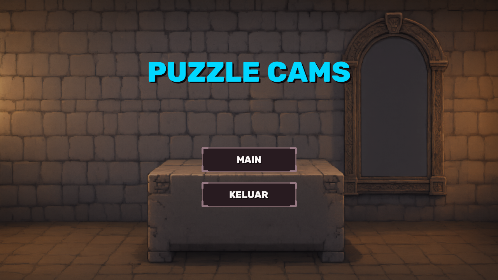
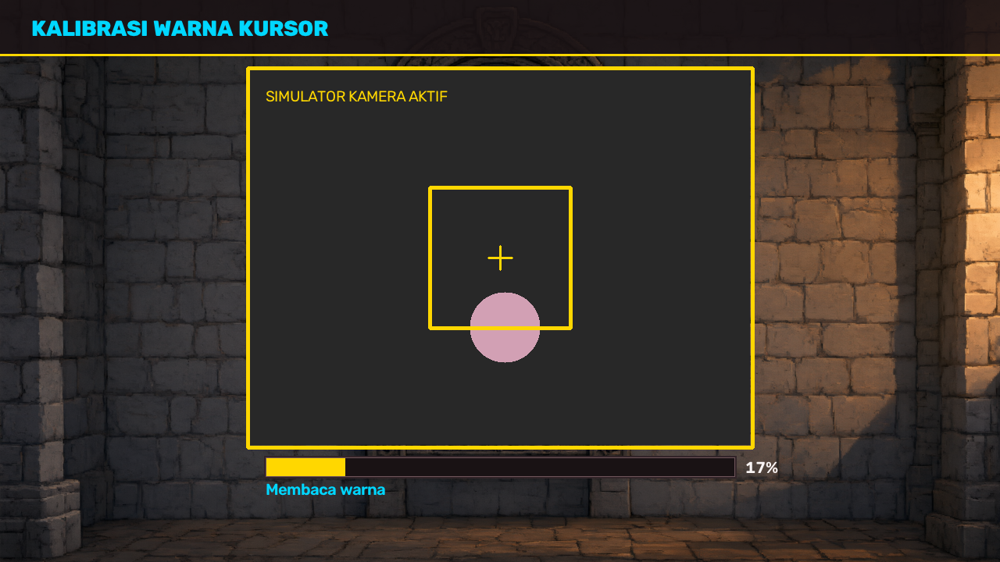
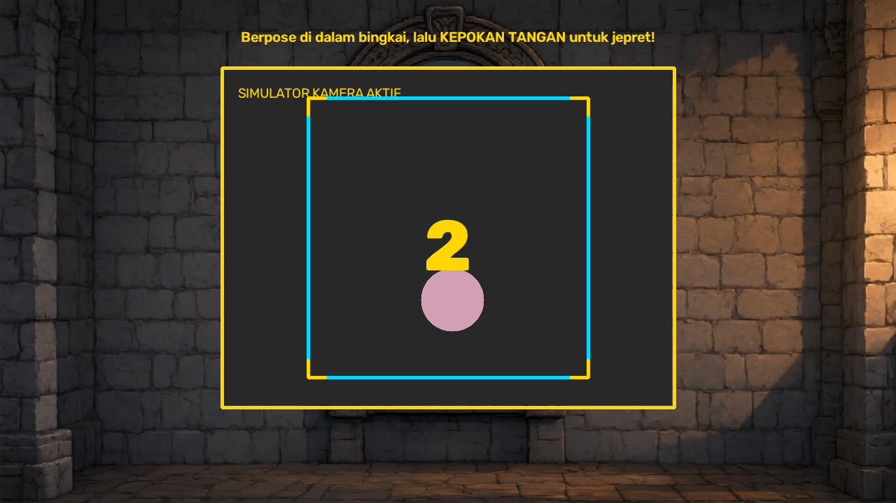
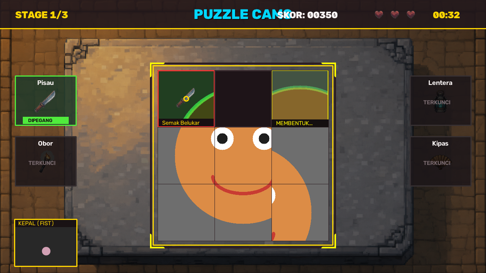
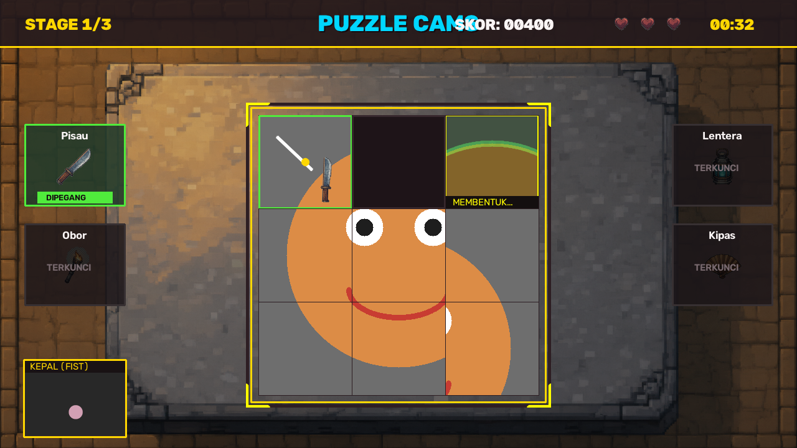

# PUZZLE CAMS - Webcam Arcade Puzzle Game
Game sliding puzzle interaktif berbasis Pengolahan Citra dan Visi Komputer (*Computer Vision*). Pemain berinteraksi langsung menggunakan gerakan dan gestur tangan yang ditangkap melalui webcam secara *real-time*.

---

## Daftar Isi
- [Gambaran Proyek](#gambaran-proyek)
- [Tangkapan Layar Permainan](#tangkapan-layar-permainan)
- [Alur Permainan (State Machine)](#alur-permainan-state-machine)
- [Sistem Kontrol & Pelacakan Tangan](#sistem-kontrol--pelacakan-tangan)
- [Mekanik Puzzle](#mekanik-puzzle)
- [Sistem Rintangan & Peralatan (Tools)](#sistem-rintangan--peralatan-tools)
- [Sistem Skor, Nyawa, dan Deadlock](#sistem-skor-nyawa-dan-deadlock)
- [Teknologi & Dependensi](#teknologi--dependensi)
- [Struktur Folder Proyek](#struktur-folder-proyek)
- [Panduan Instalasi & Menjalankan Game](#panduan-instalasi--menjalankan-game)
- [Catatan Teknis & Pemecahan Masalah](#catatan-teknis--pemecahan-masalah)

---

## Gambaran Proyek

PUZZLE CAMS menggabungkan mekanisme klasik *sliding puzzle* 3x3 dengan kontrol tanpa sentuh (*touchless gesture control*). Game mengolah aliran *frame* video kamera secara langsung untuk melacak koordinat tangan pemain, membedakan gestur terbuka vs mengepal, serta menerapkan berbagai teknik pemrosesan citra digital (PCV) sebagai bagian integral dari mekanik rintangan visual.

Seluruh logika permainan, pelacakan citra, antarmuka grafis (UI), dan visualisasi rintangan dirancang dalam satu arsitektur terintegrasi di file utama [puzzle_cams.py](file:///c:/Users/USER/Documents/game%20pcv/puzzle_cams.py).

---

## Tangkapan Layar Permainan

| Menu Utama | Kalibrasi Warna Tangan |
| :---: | :---: |
|  |  |
| *Tampilan awal game dan navigasi utama* | *Proses pembacaan sampel warna pada kotak ROI* |

| Pengambilan Foto (Pose) | Tampilan Gameplay Aktif |
| :---: | :---: |
|  |  |
| *Jepret foto wajah/objek dengan mengepalkan tangan* | *Papan puzzle 3x3, panel rintangan, dan status HUD* |

| Animasi Aksi Peralatan (*Tool Action*) |
| :---: |
|  |
| *Efek ayunan dinamis saat membersihkan rintangan pada tile* |

---

## Alur Permainan (State Machine)

Permainan dikelola oleh mesin status (*finite state machine*) yang berpindah secara berurutan:

```
[ Menu Utama ] ──(Pilih Main / [SPACE])──> [ Kalibrasi Warna ]
                                                    │
                                            (Berhasil 100%)
                                                    │
                                                    ▼
[ Permainan (Playing) ] <──(Jepret Foto)── [ Pengambilan Foto ]
       │          │
 (Selesai Stage)  (Nyawa Habis)
       │          │
       ▼          ▼
[ Stage Clear ] [ Game Over ]
       │          │
 (Lanjut / [N])   (Coba Lagi / Menu)
       │
 (Stage 3 Selesai)
       ▼
 [ Kemenangan ]
```

1. **`STATE_MAIN_MENU` (Menu Utama)**  
   Menampilkan latar belakang kastil arkade, tombol interaktif **MAIN** dan **KELUAR**, serta mendeteksi masukan mouse atau keyboard.
2. **`STATE_CALIBRATION` (Kalibrasi Warna Tangan)**  
   Pemain menempatkan tangan atau objek penanda di kotak ROI (*Region of Interest*) berukuran 180x180 piksel di tengah layar. Menekan tombol `[SPACE]` akan memulai pembacaan 30 sampel warna HSV dengan indikator *progress bar* bertahap.
3. **`STATE_CAPTURE` (Pengambilan Foto Puzzle)**  
   Pemain berpose di dalam bingkai panduan 400x400 piksel. Pemain mengepalkan tangan selama 1.5 detik (atau menekan `[SPACE]`) untuk memicu hitung mundur 3 detik. Saat hitungan selesai, efek kilatan blitz (*white flash*) muncul dan foto dipotong menjadi ukuran 450x450 piksel untuk dijadikan gambar kepingan puzzle.
4. **`STATE_PLAYING` (Gameplay Aktif)**  
   Sesi permainan utama: menggeser kepingan puzzle, memantau rintangan yang muncul di atas kepingan yang lama tidak disentuh (*idle*), mengambil peralatan di rak kiri/kanan, dan membebaskan kepingan yang terkunci.
5. **`STATE_STAGE_CLEAR` (Stage Selesai)**  
   Ditampilkan setelah pemain berhasil menyusun puzzle kembali ke urutan semula (0 sampai 8). Menampilkan foto utuh, perolehan skor, dan jeda 3 detik sebelum melanjutkan ke stage berikutnya.
6. **`STATE_VICTORY` & `STATE_GAME_OVER` (Layar Akhir)**  
   - **Kemenangan (Stage 3 Selesai):** Menampilkan skor total dan evaluasi peringkat (*Rank S* untuk skor $\ge 2600$, *Rank A* untuk skor $\ge 1800$, dan *Rank B* untuk skor lainnya).  
   - **Game Over (Nyawa Habis):** Menerapkan filter kuantisasi bit-depth 3-bit pada foto pemain untuk menghasilkan efek grafis retro terdistorsi. Tersedia tombol navigasi **MAIN LAGI**, **MENU UTAMA**, dan **KELUAR GAME**.

---

## Sistem Kontrol & Pelacakan Tangan

### 1. Segmentasi Warna HSV & Penanganan Batas Melingkar (*Hue Wrap-Around*)
Sistem membaca warna kursor dari ruang warna HSV (*Hue, Saturation, Value*) untuk memisahkan komponen warna dari fluktuasi intensitas cahaya:
- Rata-rata Hue dihitung menggunakan rumus sirkular trigonometri:
  $$\bar{\theta} = \text{atan2}\left(\frac{1}{N}\sum \sin(\theta_i),\; \frac{1}{N}\sum \cos(\theta_i)\right)$$
- Jika rentang deviasi Hue melewati batas $0^\circ$ atau $180^\circ$ (terutama untuk spektrum warna kulit atau warna merah), sistem secara otomatis mengaktifkan segmentasi ganda (*Hue Wrap-Around*) dengan menggabungkan dua rentang `cv2.inRange` menggunakan operasi logika `cv2.bitwise_or`.
- Masker biner dibersihkan dari *noise* menggunakan operasi morfologi:
  - **Opening** (kernel elips 5x5) untuk membuang bintik-bintik putih kecil (*salt-noise*).
  - **Closing** (kernel elips 7x7) untuk menutup celah dan lubang kecil di dalam area kontur tangan.

### 2. Normalisasi Ruang Kerja (*Active Margin*)
Agar tangan pemain tidak perlu meregang hingga ke tepi sudut bingkai webcam fisik untuk mencapai pojok layar (1280x720 piksel), sistem menerapkan margin aktif sebesar 18%:
- `CAMERA_MARGIN_X = 0.18` (18% batas kiri dan kanan)
- `CAMERA_MARGIN_Y = 0.18` (18% batas atas dan bawah)
- Koordinat centroid tangan di dalam zona tengah (64% area efektif) dipetakan secara proporsional ke rentang resolusi penuh layar game $[0, 1280]$ dan $[0, 720]$.
- Pergerakan kursor dihaluskan dengan *smoothing moving-average* adaptif: bobot $\alpha = 0.40$ untuk pergeseran mikro dan $\alpha = 0.70$ untuk gerakan cepat.

### 3. Klasifikasi Gestur (Tangan Terbuka vs Mengepal)
Sistem membedakan pose tangan menggunakan kombinasi tiga parameter geometris kontur citra:
1. **Solidity:** Rasio luas kontur terhadap luas *Convex Hull* ($\text{Area} / \text{ConvexArea}$). Tangan mengepal memiliki tepi cembung yang padat sehingga nilai solidity mendekati 1.0.
2. **Circularity:** Derajat kebulatan kontur ($4\pi \times \text{Area} / \text{Keliling}^2$).
3. **Area Ratio:** Perbandingan luas kontur saat ini terhadap luas referensi saat kalibrasi ($\text{Area} / \text{RefArea}$).

Skor kepal dihitung melalui pembobotan:
$$\text{FistScore} = 0.40 \times \text{Circularity} + 0.35 \times \text{Solidity} + 0.25 \times \max(0, 1.0 - \text{AreaRatio})$$

Status **Kepal (*Fist*)** dikonfirmasi jika:
- $\text{FistScore} > 0.46$, ATAU
- $\text{Solidity} > 0.88$ dan $\text{AreaRatio} < 0.75$, ATAU
- $\text{AreaRatio} < 0.50$ (penyusutan ukuran signifikan akibat jari tertekuk ke dalam).

Konfirmasi membutuhkan minimal 2 frame berturut-turut untuk mencegah kedipan (*jitter*).

### 4. Durasi Tahan Interaksi (*Hold Durations*) & Auto-Drop
- **Menggeser Kepingan Puzzle:** Arahkan kursor ke kepingan yang bersebelahan dengan kotak kosong, lalu kepalkan tangan selama **0.25 detik** (`HOLD_TIME_SLIDE_GRAB`).
- **Mengambil / Melepas Peralatan:** Arahkan kursor ke slot peralatan di panel samping, lalu kepalkan tangan selama **0.35 detik** (`HOLD_TIME_EQUIP`).
- **Membersihkan Rintangan:** Arahkan kursor yang sedang memegang alat yang cocok ke atas kepingan yang terkunci rintangan, lalu kepalkan tangan selama **0.55 detik** (`HOLD_TIME_CLEAR`).
- **Auto-Drop Alat:** Jika pemain membuka telapak tangan selama $\ge$ **0.30 detik** (`AUTO_DROP_OPEN_TIME`), alat yang sedang dipegang otomatis terlepas kembali ke rak, sehingga pemain dapat langsung melanjutkan menggeser puzzle.

### 5. Kontrol Cadangan (*Mouse Fallback*) & Tombol Keyboard
Game menyediakan kendali alternatif mouse dan tombol pintas keyboard:
- **Mouse Fallback:** Posisi kursor mengikuti kursor mouse. Menahan tombol **Klik Kiri Mouse** berfungsi menggantikan gestur mengepalkan tangan.
- **Tombol Pintas Keyboard:**
  | Tombol | Fungsi |
  | :---: | :--- |
  | `[SPACE]` | Memulai kalibrasi di layar Menu / Memulai pembacaan kalibrasi / Jepret foto instan |
  | `[ESC]` | Kembali ke Menu Utama / Keluar dari game jika berada di Menu Utama |
  | `[R]` | *Restart* permainan kembali ke kalibrasi Stage 1 |
  | `[M]` | Kembali ke Menu Utama dari layar Kemenangan atau Game Over |
  | `[N]` | *Instant Stage Clear* (melewati stage saat bermain / mempercepat jeda transisi) |
  | `[1]` – `[4]` | Memilih peralatan secara instan (1: Pisau, 2: Obor, 3: Lentera, 4: Kipas) |
  | `[0]` / `[Q]` | Melepaskan peralatan yang sedang dipegang |

---

## Mekanik Puzzle

Papan puzzle terdiri dari kisi 3x3 dengan 9 posisi kepingan berukuran 150x150 piksel (total ukuran papan 450x450 piksel). Kepingan dengan nilai indeks 8 dialokasikan sebagai **kotak kosong**.

```
[ 0 ] [ 1 ] [ 2 ]
[ 3 ] [ 4 ] [ 5 ]
[ 6 ] [ 7 ] [ 8: KOSONG ]
```

### Pengacakan Sah (*Legal Moves Shuffle*) & Jaminan 100% Solvable
Berbeda dari pengacakan permutasi acak yang dapat menghasilkan susunan puzzle matematika ganjil tak terpecahkan (*unsolvable inversion parity*), game ini menggunakan metode **Random Legal Moves**:
1. Papan dimulai dari kondisi terpecahkan sempurna `[0, 1, 2, ..., 8]`.
2. Posisi kotak kosong ditukar secara acak hanya dengan kepingan tetangga yang sah (*valid neighbors*).
3. Pertukaran bolak-balik langsung pada posisi yang sama (*undo move*) dicegah oleh sistem.
4. Jumlah langkah pengacakan disesuaikan per tingkatan stage:
   - **Stage 1:** 2 – 3 langkah acak.
   - **Stage 2:** 4 – 5 langkah acak.
   - **Stage 3:** 6 – 8 langkah acak.

Dengan metode ini, susunan puzzle dijamin **100% selalu dapat diselesaikan**.

---

## Sistem Rintangan & Peralatan (Tools)

### 1. Hubungan Rintangan, Peralatan, dan Efek Pengolahan Citra

| Rintangan | Efek Pengolahan Citra (PCV) | Peralatan Pembebas | Efek Visual Peralatan |
| :--- | :--- | :--- | :--- |
| **Semak Belukar** (*Bush*) | Deteksi gradien magnitudo **Filter Sobel 3x3** ($G = \sqrt{S_x^2 + S_y^2}$), **Dilasi Morfologi** 2 iterasi untuk menumbuhkan sulur, dan pewarnaan hijau gelap. | **Pisau** (*Knife*, Slot 1) | Animasi busur tebasan pisau berotasi $-35^\circ \to +45^\circ$ disertai garis tebasan putih (*slash trail*). |
| **Es Beku** (*Ice*) | Transformasi inversi warna **Look-Up Table (LUT) Negatif 256**, **Median Filter 7x7** untuk menghasilkan tekstur kristal es, dan tinting biru dingin. | **Obor** (*Torch / Hairdryer*, Slot 2) | Animasi mendekat (*reach*) dengan bara api melingkar oranye yang bergetar secara dinamis. |
| **Kutukan Gelap** (*Dark Curse*) | Transformasi daya non-linear **Gamma 4.0** ($I_{out} = I_{in}^{4.0}$), dikombinasikan dengan gradasi **Vignette Radial** ungu pekat dari sudut tile. | **Lentera** (*Lantern / Flashlight*, Slot 3) | Animasi lentera terangkat ke atas disertai pancaran cincin cahaya (*expanding light halo*) berwarna kuning/sian. |
| **Kabut Tebal** (*Dense Fog*) | Penghalusan frekuensi spasial rendah **Gaussian Blur 15x15**, dilapisi *overlay* kabut putih susu dengan transparansi 55%. | **Kipas** (*Fan / Sponge*, Slot 4) | Animasi kipas mengibas kiri-kanan secara sinusoidal berotasi $\pm 30^\circ$ disertai hembusan angin busur. |

### 2. Progresi Rintangan per Stage
- **Stage 1:** Hanya rintangan *Semak Belukar*. Peralatan yang aktif: *Pisau*.
- **Stage 2:** Rintangan *Semak Belukar* dan *Es Beku*. Peralatan yang aktif: *Pisau* dan *Obor*.
- **Stage 3:** Seluruh 4 rintangan dan 4 peralatan aktif secara bersamaan.

### 3. Siklus Rintangan Dua Tahap (*Two-Stage Obstacles*)
Rintangan muncul secara berkala setiap **15.0 detik** (`OBSTACLE_SPAWN_INTERVAL`). Target dipilih secara otomatis pada kepingan yang paling lama tidak disentuh pemain (*most idle tile*).
1. **Tahap 1 (`FORMING` / Pembentukan - 1.5 Detik):**  
   - Efek visual rintangan bergradasi perlahan dari 0% ke 100% menggunakan *alpha blending* waktu nyata.
   - Garis batas tile berdenyut (*pulsing*) oranye kemerahan dan menampilkan teks status `"MEMBENTUK..."`.
   - **Kepingan belum terkunci:** Pemain masih dapat menggeser kepingan ini sebelum pembentukan selesai.
2. **Tahap 2 (`PERMANENT` / Mengeras):**  
   - Rintangan menutupi kepingan secara penuh dan menampilkan label nama rintangan.
   - **Kepingan terkunci:** Kepingan tidak dapat digeser oleh pemain sampai dibersihkan menggunakan alat yang sesuai.

---

## Sistem Skor, Nyawa, dan Deadlock

### 1. Sistem Nyawa & Skor
- Pemain dibekali **3 nyawa** (ditampilkan dengan ikon hati di HUD kanan atas).
- **Penambahan Skor:**
  - Membersihkan 1 rintangan dengan peralatan: **+50 poin**.
  - Menyelesaikan Stage 1: **+300 poin**.
  - Menyelesaikan Stage 2: **+600 poin**.
  - Menyelesaikan Stage 3: **+900 poin**.
  - **Bonus Kecepatan (Speed Bonus):** $\max(0, (90 - \text{waktu dalam detik}) \times 10)$.

### 2. Mekanisme Kebuntuan (*Deadlock*)
Kondisi kebuntuan (*deadlock*) terpicu secara otomatis jika:
1. Seluruh kepingan tetangga yang berada di sekeliling kotak kosong berstatus rintangan `PERMANENT` (tidak ada kepingan yang dapat digeser sama sekali), ATAU
2. Terdapat $\ge 6$ kepingan pada papan yang terkunci oleh rintangan permanen secara bersamaan.

**Konsekuensi Terjadinya Deadlock:**
- Layar permainan berkedip merah terang selama 0.5 detik.
- Nyawa pemain berkurang 1.
- Penalti skor: **-200 poin** (skor tidak akan turun di bawah 0).
- **Pembersihan Darurat:** Seluruh rintangan di papan langsung dihapus secara otomatis, **tanpa me-reset posisi susunan kepingan puzzle**, sehingga pemain dapat langsung melanjutkan permainan tanpa kehilangan progres penyusunan.
- Permainan berakhir (*Game Over*) jika seluruh 3 nyawa habis.

---

## Teknologi & Dependensi

Proyek ini dibangun menggunakan Python dan pustaka pengolahan citra standar:
- **Python 3.8+**
- **OpenCV (`opencv-python`):** Akuisisi frame webcam, konversi ruang warna HSV/BGR/Gray, filter Sobel, Gaussian blur, Median blur, operasi morfologi opening/closing/dilasi, ekstraksi kontur dan momen spasial, manipulasi matriks affine rotasi, dan overlay grafis GUI.
- **NumPy (`numpy`):** Operasi array citra multidimensi, pembuatan tabel Look-Up Table (LUT), perhitungan statistik piksel (mean sirkular, standar deviasi sirkular, dan persentil).
- **Pillow (`PIL`):** Generator aset cadangan prosedural berbasis tipografi font jika file grafis eksternal perlu dibuat ulang otomatis.

---

## Struktur Folder Proyek

```
game pcv/
├── assets/
│   ├── bg gameplay.png                     # Gambar latar belakang saat permainan aktif
│   ├── bg kalibrasi dan tangkap gambar.png # Gambar latar belakang layar kalibrasi & capture
│   ├── bg main menu.png                    # Gambar latar belakang layar Menu Utama
│   ├── flashlight.png                      # Ikon peralatan Lentera (Slot 3)
│   ├── frame.png                           # Bingkai batu hiasan di sekeliling papan puzzle
│   ├── hairdryer.png                       # Ikon peralatan Obor (Slot 2)
│   ├── hand_fist.png                       # Ikon kursor mode mengepal
│   ├── hand_open.png                       # Ikon kursor mode tangan terbuka
│   ├── heart.png                           # Ikon indikator nyawa di HUD
│   ├── knife.png                           # Ikon peralatan Pisau (Slot 1)
│   └── sponge.png                          # Ikon peralatan Kipas (Slot 4)
├── docs/
│   └── images/
│       ├── calibration.png                 # Tangkapan layar antarmuka kalibrasi warna
│       ├── capture.png                     # Tangkapan layar antarmuka pengambilan foto
│       ├── gameplay.png                    # Tangkapan layar antarmuka permainan aktif
│       ├── main_menu.png                   # Tangkapan layar antarmuka Menu Utama
│       └── tool_action.png                 # Tangkapan layar animasi tebasan alat pisau
├── puzzle_cams.py                          # Kode sumber utama aplikasi game
└── README.md                               # Dokumentasi lengkap proyek
```

---

## Panduan Instalasi & Menjalankan Game

### 1. Pasang Dependensi
Pastikan Python sudah terpasang di komputer Anda. Buka terminal atau Command Prompt, lalu instal paket yang dibutuhkan:

```bash
pip install opencv-python numpy pillow
```

### 2. Jalankan Permainan
Eksekusi file utama program:

```bash
python puzzle_cams.py
```

---

## Catatan Teknis & Pemecahan Masalah

1. **Pencahayaan Ruangan saat Kalibrasi Warna:**
   - Gunakan ruangan dengan pencahayaan yang cukup dan merata. Hindari lampu sorot langsung ke arah lensa kamera yang menimbulkan pantulan cahaya (*glare*).
   - Pastikan latar belakang di belakang pemain tidak memiliki warna yang identik dengan telapak tangan atau objek yang dikalibrasi.
   - Posisikan telapak tangan diam di dalam kotak ROI kuning selama 1 – 2 detik hingga bilah progres mencapai 100%.

2. **Simulator Kamera Virtual Otomatis (*Fallback Simulator*):**
   - Jika komputer tidak memiliki webcam fisik, atau webcam sedang dipakai oleh aplikasi lain (seperti Zoom, Teams, atau browser), game tidak akan mengalami *crash*.
   - Game otomatis mendeteksi ketiadaan kamera dan mengaktifkan **Simulator Kamera Virtual** bawaan, menampilkan target lingkaran warna terkalibrasi yang bergerak secara periodik untuk keperluan pengujian logika.

3. **Penggunaan Mode Mouse untuk Pengujian Cepat:**
   - Jika ingin mendemonstrasikan atau menguji mekanik puzzle tanpa menggunakan kamera fisik, cukup gunakan mouse: gerakkan kursor mouse ke posisi kepingan atau panel alat, lalu tekan dan tahan tombol **Klik Kiri Mouse** untuk mengaktifkan aksi kepal.
